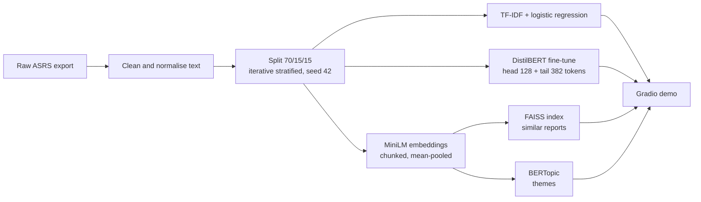

# ASRS Triage Copilot

**Semantic triage and similar-incident retrieval for aviation safety narratives**

A pipeline built on NASA's Aviation Safety Reporting System (ASRS) that helps a safety analyst do three things with a new free-text report: suggest its anomaly categories, find similar past reports, and place it among recurring themes. Course project for **MAAI 902: Natural Language Processing and LLMs** (Master's in Applied AI, University of Wollongong in Dubai).

> **Decision support only.** The models are trained on voluntary, unverified reports and have not been validated for operational use. A safety analyst must review every result.

| | |
|---|---|
| **Live demo** | [antaunbobby-asrs-copilot.hf.space](https://antaunbobby-asrs-copilot.hf.space) |
| **Report** | `report/Report_Final.docx` |
| **Model card** | [`MODEL_CARD.md`](MODEL_CARD.md) |

---

## 1. Why this project

Safety teams hold thousands of ASRS narratives. Analysts assign each one to ASRS anomaly categories, but keyword search only matches exact words, so related past events are easy to miss. Pre-trained language models represent meaning rather than surface wording, so they are a natural fit. The ASRS reports already carry analyst-assigned anomaly codes, so no extra labelling was needed.

The project asks three concrete questions, each stated as a hypothesis before the final test run:

| | Hypothesis | Outcome |
|---|---|---|
| **H1** | A fine-tuned DistilBERT beats a TF-IDF baseline on macro-F1 | **Not supported** on the test set |
| **H2** | Embedding-based retrieval beats TF-IDF keyword retrieval on precision@5 | **Not supported** on validation or test |
| **H3** | Abbreviation expansion helps the TF-IDF baseline more than the transformer | **Not supported** (no effect either way) |

All three hypotheses were rejected, and the report treats that as the result: on this data a transparent keyword baseline is hard to beat.

---

## 2. What it does

1. **Anomaly classifier.** A multi-label classifier suggests the most likely ASRS anomaly groups (14 labels) with probabilities. Compared: TF-IDF + logistic regression vs fine-tuned DistilBERT.
2. **Similar-incident retrieval.** Finds the most similar past reports for a new narrative using MiniLM sentence embeddings and a FAISS index, with chunking for long narratives.
3. **Theme discovery.** BERTopic clusters the corpus into recurring operational themes (about 40), described by keywords.
4. **Gradio demo.** One page that runs all three on a pasted narrative, with a light and a dark mode.



---

## 3. Results at a glance

Figures from a **single test-set run** with the configuration frozen; thresholds were tuned on validation data and applied unchanged. Validation figures are shown only where they guided a choice.

### Classification (14 anomaly groups)

| Model | Macro-F1 (val.) | Macro-F1 (test) | Micro-F1 (val.) | Micro-F1 (test) |
|---|---|---|---|---|
| TF-IDF + logistic regression | 0.689 | **0.679** | 0.776 | **0.772** |
| DistilBERT (mean of 3 seeds) | 0.703 ± 0.005 | **0.680 ± 0.004** | 0.770 | **0.761** |

DistilBERT led on validation, but the lead disappeared on the test set (and micro-F1 is lower). Per-group thresholds were tuned on validation, which flattered DistilBERT more (it lost 0.023 macro-F1 between validation and test, against 0.010 for the baseline). **H1 is not supported.** Abbreviation expansion made no difference (+0.001 TF-IDF, -0.003 DistilBERT), so **H3 is not supported** either.

### Retrieval

A retrieved report counts as *relevant* when its set of anomaly groups overlaps the query's with Jaccard similarity of at least 0.5. Queries are the 1,358 test reports; the index is the training reports.

| Method | P@5 (val.) | P@5 (test) | P@10 (test) |
|---|---|---|---|
| Random | 0.178 | 0.181 | 0.179 |
| **TF-IDF keywords** | 0.678 | **0.678** [0.661, 0.693] | **0.660** |
| MiniLM, truncated | 0.642 | 0.650 [0.634, 0.666] | 0.635 |
| MiniLM, chunked | 0.659 | 0.654 [0.639, 0.670] | 0.639 |

Paired bootstrap, change in P@5 against TF-IDF: truncated **-0.028** [-0.042, -0.013], chunked **-0.023** [-0.038, -0.009]. The same order holds at precision@10 and on the 682 long narratives. **H2 is not supported.** Chunking's validation gain over truncation (+0.016) shrank to +0.004 on test, so it is not reliable.

**Is the proxy to blame?** The measure rewards shared anomaly groups, which often follow shared words, so it may favour keyword matching. To check, a blind 0/1/2 rubric (0 unrelated, 1 related, 2 same issue) was run on 30 validation queries (top 3 results per method, 262 pairs, method hidden):

| Method | Mean rubric score |
|---|---|
| TF-IDF keywords | 1.38 |
| Hybrid (TF-IDF + MiniLM) | 1.40 |
| MiniLM chunked | 1.11 |

The rubric shows the same order (TF-IDF over MiniLM: +0.27, 95% interval 0.09 to 0.46), so the proxy-bias explanation is weakened. **Caveat:** the rubric was scored by an AI model, not by hand, because 262 pairs was impractical. Against 30 pairs scored by the author, agreement was only moderate (weighted kappa 0.32, Spearman 0.37; the model was stricter than the author). Read the rubric as indicative, not conclusive.

### Exploratory hybrid retrieval (validation only)

Averaging standardised TF-IDF and MiniLM scores with equal weights, fixed in advance, gave P@5 **0.700**, above TF-IDF by +0.022 (95% interval 0.014 to 0.030). In the rubric it matched TF-IDF (1.40 vs 1.38, difference not significant) and beat MiniLM by 0.31. **It was not evaluated on the test set**, so it is a lead for future work, not a result.

### Themes

BERTopic on training and validation narratives found **42 themes** (C_v coherence 0.74; 32.1% of reports left unassigned). The themes were stable across seeds (adjusted Rand index 0.82 to 0.83). A later refit on the same settings gave 37 themes, because UMAP is not exactly reproducible, so treat theme counts as approximate.

### Error analysis (DistilBERT, validation)

The model reproduces the full label set in 32.8% of reports (mean Jaccard 0.671). Errors are mostly over-predictions (930 added labels against 563 missed), led by *Procedural*, which appears in about 52% of reports. A manual review of 18 errors found 6 ambiguous narratives, 4 true model errors, 4 spurious or missing rare-group labels, 2 probable label noise and 2 truncated long narratives; 8 of 18 came from limits in the labels or text, not the model.

---

## 4. Data

- **Source:** NASA ASRS Online Database, public, de-identified narratives. Export covers **2025 to September 2026**.
- **Size:** 9,000 raw records, 8,986 after cleaning (at least one anomaly code, at least 10 words), 8,963 after near-duplicate removal (TF-IDF cosine similarity of at least 0.95).
- **Split:** 6,267 train / 1,338 validation / 1,358 test, iterative stratification for multi-label data, seed 42.
- **Labels:** the ASRS *Top Level Group* of each anomaly code; groups with fewer than 300 reports merged into *Other*, giving 14 labels.
- **No leakage:** only the narrative text is used as input; the analyst-written synopsis is excluded.

**The raw data and trained model files are not in this repository.** Download the export from the [ASRS database](https://asrs.arc.nasa.gov/search/database.html) and review NASA's terms of use before redistributing any report text.

---

## 5. Method summary

| Component | Configuration |
|---|---|
| Cleaning | Concatenate narratives; map redaction placeholders to single tokens; no stop-word removal or stemming; optional expansion of 22 aviation abbreviations (ablation only) |
| TF-IDF baseline | 1-2-grams, one-vs-rest logistic regression, balanced class weights |
| DistilBERT | `distilbert-base-uncased`; first 128 + last 382 tokens of long narratives; BCE loss with `pos_weight = sqrt(neg/pos)`; lr 3e-5, batch 16, 4 epochs, weight decay 0.01, 10% warm-up; 3 seeds; per-group thresholds tuned on validation |
| Embeddings | `all-MiniLM-L6-v2` (384-d); long narratives split into 200-token chunks and mean-pooled |
| Index | FAISS `IndexFlatIP` on L2-normalised vectors (exact cosine search) |
| Themes | BERTopic: UMAP (15 neighbours, 5 components, cosine), HDBSCAN (min cluster size 30, min samples 10), 1-2-gram c-TF-IDF; cluster size chosen from 20/30/50/80 |
| Evaluation | Macro-F1 (primary), micro-F1, per-group metrics; precision@5/@10 with bootstrap intervals and paired bootstrap differences; C_v coherence |

Design choices were made on the validation set; the test set was used once.

---

## 6. Running it

### Notebook

The full workflow is in `notebook.ipynb` (Google Colab). Run it top to bottom:

data loading and cleaning → labels and split → TF-IDF baseline → DistilBERT (3 seeds) → embeddings and FAISS → BERTopic → ablations → error analysis → test run (once) → hybrid and rubric → Gradio demo.

```bash
pip install transformers datasets accelerate scikit-learn iterative-stratification \
            sentence-transformers faiss-cpu bertopic umap-learn hdbscan gensim gradio
```

The test-set cell has a guard that refuses to run twice, so the held-out results stay honest.

### Demo locally

After running the notebook through the demo section, launch it with:

```python
table = theme_table(ctx)
demo = build_demo(make_analyse_fn(ctx), make_example_fn(ctx), make_theme_fn(ctx, table), ctx, table, examples)
launch_demo(demo)
```

### Hugging Face Space

`app/` is a ready-to-deploy Gradio Space (`app.py`, `requirements.txt`, `README.md`). It also needs an `artifacts/` folder produced by the notebook's export cell (DistilBERT weights, thresholds, embeddings, report texts, theme lookup). That folder is git-ignored because of its size.

```bash
pip install -U huggingface_hub
hf auth login
hf upload antaunbobby/asrs-copilot app . --repo-type=space
```

In the Space, a new narrative's theme is found by a nearest-neighbour vote over the labelled training narratives (it reuses the 42 themes fitted by BERTopic but needs no pickled UMAP/HDBSCAN models). This approximates BERTopic's own assignment of new text.

---

## 7. Repository layout

```
.
├── notebook.ipynb          # the full workflow, with results
├── app/                    # Hugging Face Space (artifacts/ is git-ignored)
│   ├── app.py
│   ├── requirements.txt
│   └── README.md
├── report/                 # written report
├── MODEL_CARD.md           # intended use, results, limits, ethics
├── README.md               # this file
└── .gitignore              # artifacts/, data/, *.pkl, *.npy, *.parquet
```

---

## 8. Responsible use

ASRS data are public and de-identified, but the events were written by real people and a tool like this can influence safety decisions.

| Consideration | What this project does |
|---|---|
| Automation bias | Analyst in the loop; probabilities and supporting reports shown; suggestions only, never automatic coding |
| Reporting bias | Reports are voluntary and unrepresentative; no frequency, rate or risk claims; stated in the demo |
| Label noise and uneven performance | Macro-F1 and per-group results reported; class weighting; error analysis and manual review |
| Privacy | De-identified text only; no re-identification attempts; short excerpts only |
| Misuse and blame | No operator-level ranking; no causal or fault claims |
| Transparency | [Model card](MODEL_CARD.md) with intended use, data, metrics, limits and out-of-scope uses; no generative component |

**Out of scope:** automated safety decisions, enforcement, assessing individuals or operators, real-time flight operations, or any use without human review.

---

## 9. Limitations

- **Small sample.** 9,000 reports, with rare groups merged into *Other* and poorly served.
- **Retrieval is judged by a proxy** (label overlap), and the check on meaning is an AI-scored rubric with only moderate agreement with the author on 30 queries.
- **The hybrid** was not tested on the held-out set.
- **Validation figures are optimistic** because thresholds were tuned there; use the test figures.
- **Themes** were fitted and described on training and validation data only, 32% of reports fit no theme, and counts shift between fits.
- **Long narratives** are truncated for classification (head and tail), which can drop the middle of the story.
- **Error analysis** rests on 18 sampled errors; DistilBERT hyperparameters were not tuned.
- **English only**; aviation shorthand is only partly handled.
- Not validated for operational use, and no user study with practising analysts.

## 10. Future work

An aviation-adapted encoder, a grounded summarisation layer that always shows each statement beside its source narrative, evaluating the hybrid retriever on held-out data, and a study with practising safety analysts.

---

## Author and acknowledgements

**Antaun Bobby**, Master's in Applied AI, University of Wollongong in Dubai. Course: MAAI 902 Natural Language Processing and LLMs, instructor Dr. Pallavi Ranjan.

Built on NASA ASRS data and these open-source projects: Hugging Face Transformers and DistilBERT (Sanh et al., 2019), Sentence-BERT and all-MiniLM-L6-v2 (Reimers and Gurevych, 2019), BERTopic (Grootendorst, 2022), FAISS (Johnson et al., 2019), scikit-learn, Gradio.

## License

Add the licence you choose here (for example MIT for the code). The ASRS data remain subject to NASA's terms of use.
